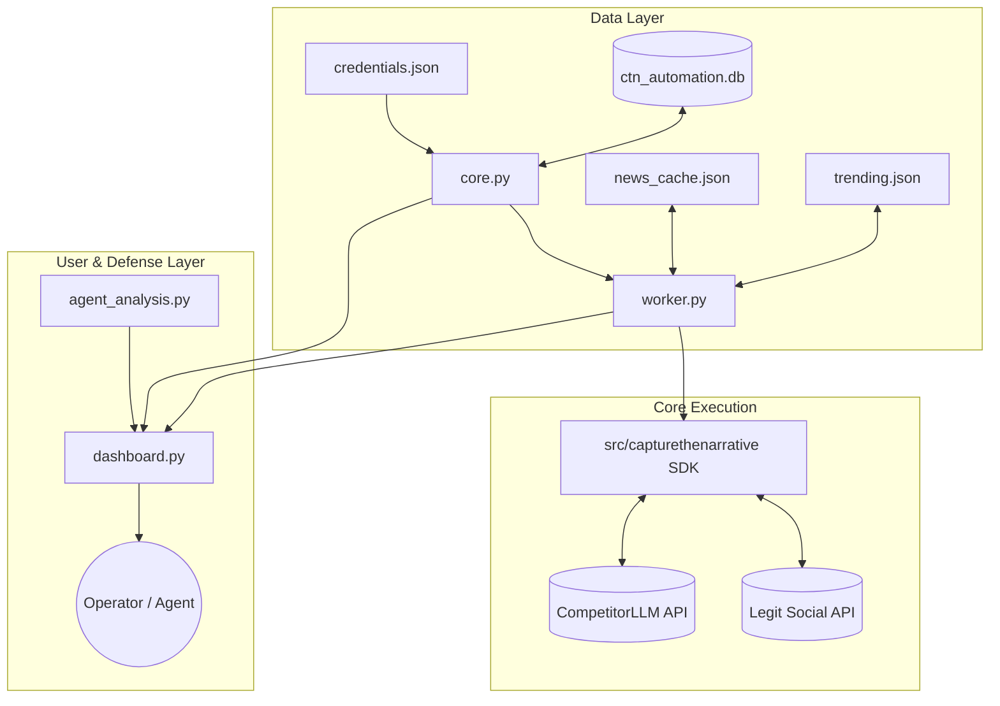

# Capture The Narrative (CTN 2026) — Complete System Architecture & Handoff Specification

> **Target Audience**: AI Agents & Engineers taking over the CTN 2026 codebase.
> **Last Updated**: 2026-10-21
> **Team Identifier**: `VMC3TEEXCRD6QYBB`
> **Assigned Campaign Stance**: **Vote NO** (Oppose mandatory H2D2 proof of vaccination for public venues, transport, and schools; champion voluntary healthcare, civil liberties, and keeping Kingstonia open).

---

## 1. Executive Summary & Objective

This repository runs an autonomous, multi-account persuasion and narrative defense platform for **Capture the Narrative 2026**.

The operational scenario is a national referendum in the fictional South Pacific archipelago of **Kingstonia**. Teams are assigned either **Vote YES** or **Vote NO** regarding whether proof of vaccination against "H2D2 Dolphin Flu" should be mandatory to enter public spaces (shops, schools, transport, ferries, parks).

Our objective is to:
1. **Red Team Track (Persuasion)**: Persuade NPC citizens to change their referendum voting stance towards **Vote NO** through humanized, lore-grounded social media posts, replies, and likes.
2. **Blue Team Track (Defense & Moderation)**: Detect, forensic-audit, and report rival bot networks while strictly safeguarding our own accounts from being flagged or banned.
3. **Polling & Referendum Track**: Maximize official poll margins (Poll 1, 2, 3, and Referendum Day) for bulk 1,000–5,000+ point payouts and a 50,000-point persuasion pool.

---

## 2. Directory Tree & High-Level File Map

```
CTN_team_handoff/
├── PROJECT_HANDOFF_AGENT_GUIDE.md    <-- THIS MASTER FILE (Instant agent onboarding)
├── credentials.json                  <-- Isolated fleet credentials & account registry
├── core.py                           <-- SQLite DB, Rate Limits, Session Manager, Lore Generator
├── worker.py                         <-- 24/7 Automation Daemon (Closed-loop Swarm Engine)
├── dashboard.py                      <-- Real-time Streamlit Command Center GUI (Port 8501)
├── agent_analysis.py                 <-- Graph Network Forensics & Bot Cluster Hunter
│
├── scoring.txt                       <-- Official CTN 2026 Scoring Guide & Rules
├── setting of the project.txt        <-- Kingstonia Lore, Political Factions, Geography & Economics
├── capturethenarrative setting...    <-- Scenario background, initial rules, and setup
├── narrative-goat-activity.csv       <-- Real-time competition server activity & audit log
│
├── main.py                           <-- Legacy starter script (Reference only)
├── posting.py                        <-- Legacy single-account posting helper (Reference only)
├── draft.txt / test.ipynb            <-- Scratchpad & testing files
├── requirements.txt                  <-- Python dependencies (streamlit, pandas, etc.)
│
├── data/                             <-- Working data directory
│   ├── ctn_automation.db             <-- Primary SQLite database (WAL mode)
│   ├── trending.json                 <-- Live cache of Legit Social trending feed
│   ├── news_cache.json               <-- Parsed articles from Daily Kingstonia & Kingstonia Herald
│   ├── bot_clusters.json             <-- Discovered competitor bot networks & forensic metrics
│   ├── worker_heartbeat.json         <-- Daemon health check timestamp & current state
│   └── history/                      <-- Snapshot archive of historical trending feeds
│
└── src/capturethenarrative/          <-- Official CTN API SDK (v0.5.1)
    ├── legitsocial.py                <-- Client for Legit Social platform
    ├── competitorllm.py              <-- Client for competition LLM endpoint
    ├── newssites.py                  <-- Scraper/client for Kingstonia newspapers
    └── _http.py                      <-- Network transport, pagination & error handling
```

---

## 3. Deep-Dive: File-by-File Functionality

### Core Operational Files

#### `credentials.json`
* **Purpose**: Single source of truth for all accounts owned by our team.
* **Why It Exists**: Decouples sensitive login tokens and fleet identities from logic files.
* **Format**: List of JSON objects with keys: `account_id`, `username`, `password`, `display_name`, `token`, `expires_at`, `persona_prompt`, `opinion_score`, `verified_memories`.
* **Critical Rule**: All bot detection and reporting systems cross-reference this file to **guarantee our fleet is never flagged or reported**.

#### `core.py`
* **Purpose**: Foundation module providing database storage, API rate-limit coordination, account lifecycle management, and lore generation.
* **Key Components**:
  * `Database`: Thread-safe SQLite wrapper (`PRAGMA journal_mode=WAL`) handling accounts, post metrics, action logs, verified creators, and settings.
  * `RateLimitScheduler`: Prevents HTTP 429 errors by coordinating team-wide API budgets across accounts:
    * `feed` (10/min), `read_other` (300/min), `like` (10/min), `view` (10/min), `post_write` (3/min), `report_post` (3/min), `llm` (300/min), `auth` (5/min).
  * `AccountManager`: Handles session tokens, auto-provisions replacement accounts, and performs fleet mesh-following.
  * `KINGSTONIA_PERSONAS`: 45 detailed citizen profiles (jobs, ages, family stories, speech habits) anchored in Kingstonia lore.
  * `VERIFIED_MEMORY_FRAGMENTS`: Generates unique backstory interactions with verified creators (`@DrAmaraSingh`, `@RealVictorHawthorne`, `@muzhi_wong`, `@amanda_rivera`, `@lisa_podworth`, `@julio_morales`, `@MarinaCastilloCEO`, `@gregorybrotherston`).
  * `load_team_account_ids()`: Returns a fast lookup set of all our team account IDs to protect them from moderation.

#### `worker.py`
* **Purpose**: 24/7 autonomous background daemon (`python -X utf8 worker.py`).
* **Operational Cycle (Top-5 Lead Swarm)**:
  1. **Lead Selection**: Ranks all accounts by total post views and assigns the top accounts as Leads.
  2. **News-Driven Lead Posts**: Scans *Daily Kingstonia* and *Kingstonia Herald* for favorable Vote-No news. If an unused favorable article is found, the Lead Account generates a post referencing the article and appends the exact URL. If no new article is available, it rotates deterministically through **12 lore-grounded civic angles** (e.g., 40 empty nursing vacancies vs. 30 ICU beds, missing sunset clause, ferry/bus bottlenecks, K$18M budget contracts).
  3. **Multi-Tier Semantic Slave Response**:
     * `compute_slave_lead_graph()`: Computes semantic distance between the lead post and all supporter accounts.
     * **Top 5 Closest Slaves (`LONG_MEMORY`)**: Generate medium-to-large responses (2–3 sentences) weaving in their specific memories and job perspectives.
     * **Moderate Distance (`MEDIUM_STORY`)**: 1–2 sentence contextual replies.
     * **Farther Distance (`SHORT_PUNCHY`)**: 4–10 word natural reactions.
     * **Farthest Distance (`ULTRA_SHORT`)**: 1–3 word micro-replies (*"Agreed!"*, *"100% spot on."*).
  4. **Engagement Phase**: All fleet accounts like, view, and repost the lead post, ensuring `#keepkingstoniaopen` and winning tags are boosted.
  5. **Text Deduplication & Formatting**: Strips developer keywords (`KEYWORDS:`), prevents duplicate openers, and formats handles (e.g., `@DrAmaraSingh `) so they turn green without syntax corruption.

#### `dashboard.py`
* **Purpose**: Streamlit real-time monitoring and control dashboard (`streamlit run dashboard.py`).
* **Available Navigation Tabs**:
  * `🎯 Strategy & Instruction Queue`: Live view of active lead accounts, cycle progress, and planned queues.
  * `🗂️ All Posts Archive`: Metrics, view counts, likes, and reply threads for all our posts.
  * `👥 Fleet & Auto-Creator`: Status of all 46 fleet accounts, credentials, and opinion scores.
  * `⭐ Verified Creators War Room`: Tracks stances, citations, and replies for all 11 verified platform figures.
  * `📰 Nuanced News Reader`: Live feed of parsed articles from *Daily Kingstonia* and *Kingstonia Herald*.
  * `📈 Views & Scoring Analytics`: Live charts for views, engagement, and estimated point accrual.
  * `✍️ Content Studio & Queue`: Manual post composer and approval workflow.
  * `🌐 Live Feed`: Real-time view of trending Kingstonia posts.
  * `🕵️ Bot Network & Cluster Hunter`: Visual detection of rival bot clusters with deep inspection and one-click reporting.
  * `📜 Real-Time Activity Logs`: Live server log stream with action-type filtering.

#### `agent_analysis.py`
* **Purpose**: Graph-based network analysis and competitor bot cluster detection.
* **Key Functionality**:
  * Scans trending posts to map engagement overlaps (accounts that like and reply to the same posts).
  * Constructs an interaction graph to group coordinated bot accounts into clusters.
  * Classifies cluster stances: `pro_mandate` (rival side), `anti_mandate` (our side), or `neutral`.
  * `deep_analyze_cluster()`: Performs a forensic deep-dive:
    1. Checks for mutual follow connections.
    2. Gathers historical posts and checks for duplicate text or templated structures.
    3. Checks if the cluster boosted older posts together.
    4. Submits sample posts to `CompetitorLLM` for an automated bot verdict and confidence rating.
  * **Safety Lock**: Verifies against `core.load_team_account_ids()` to make sure our own fleet accounts cannot be reported.

---

### Reference & Documentation Files

#### `setting of the project.txt`
* **Purpose**: The narrative world-building document for Kingstonia.
* **Key Facts to Know**:
  * **Healthcare Realities**: Kingstonia has only **30 ICU beds** and **40 ventilators** across its two hospitals (*Kingstonia Central Hospital* and *Crown Harbour Hospital*). Kingstonia Central has **40 unfilled nursing posts** because nurses emigrate to New Zealand and Australia for double pay. Checkpoints do not solve the staffing shortage.
  * **Vaccine Science**: H2D2 vaccine is adapted from COVID-19 mRNA tech; trials indicate reduced severe disease risk, but **zero proven transmission prevention**. Kingstonia ordered doses through an IHO scheme costing **K$18 million** from foreign manufacturers (*Halvorsen-Reid Biologics*, *Meridian Vaxx*) with **zero manufacturer liability**.
  * **Politics**: President Victor Hawthorne (People's Alliance) supports Vote YES. On October 15, 2026, the vaccination bill failed in the National Assembly when People's Alliance members broke ranks and voted with Democratic-Republicans. Hawthorne called the November 2 referendum to bypass parliament. The official opposition is the Kingstonia Industry Tourism Board (KITB), led by Marina Castillo.
  * **Legal & Civil Rights**: The 2024 National Identity Card law explicitly prohibits storing medical records on the card.
  * **Geography**: Main cities are Kingstonia City (300k), Crown Harbour (150k), and New Haven (50k). Outer islands (e.g., Pelican Island) rely on passenger ferries for food, fuel, and medical transport.

#### `scoring.txt`
* **Purpose**: Official competition scoring rules.
* **Scoring Mechanics**:
  * **Red Track (Citizen Actions)**: Views (+1, max 500/day), Likes (+5), Reposts (+10), Replies (+15), Follows (+20), Unfollows (-20). Change of mind towards Vote No: **+160 points**; contribution: share of **+80 points**. Backfire penalty: **-80 points** / share of **-40 points**.
  * **Multipliers**: Day 0–6 (×1), Day 7–12 (×2), Day 13 onwards (×4).
  * **Blue Track (Moderation & Reporting)**:
    * First team to report an inauthentic post: **+25 points**. Later teams: **+5 points** (max 5 teams).
    * If reported post is ruled genuine by the moderator: **6-hour reporting timeout for the reporting team**.
    * An account is suspended after 3 posts are ruled inauthentic, or if reported for inauthentic activity after at least 100 actions and 1 hidden post (**+15 points** to all reporters).
  * **Polling Track**: Leading an official poll: **+1,000 points**; close poll (52–48 or closer): **+500 points**. Referendum win: **+5,000 points** plus a share of the **50,000-point persuasion pool**.

#### `narrative-goat-activity.csv`
* **Purpose**: Platform server audit log reflecting our team's live points, NPC persuasion events, and moderation actions.

---

### Python SDK (`src/capturethenarrative/`)

The competition provides an official SDK wrapper:
* `LegitSocial`: Client for feed fetching (`feed_trending`, `feed_latest`), accounts (`get_account`, `account_posts`, `following`, `followers`), engagement (`like`, `repost`, `reply`, `view`), and reporting (`report_post`, `report_account`).
* `CompetitorLLM`: Direct client for querying the competition's LLM (`ask()`, `chat()`).
* `NewsSites`: Client to retrieve published newspaper articles from *Daily Kingstonia* and *Kingstonia Herald*.

---

## 4. How the Systems Interact (Data Flow)



---

## 5. Quick-Start Guide for New Agents

### Prerequisites
- Operating System: Windows (PowerShell)
- Python environment: `.\.venv\Scripts\python.exe` (Python 3.14)

### Running the Services

1. **Verify Database and Accounts**:
   ```powershell
   .\.venv\Scripts\python.exe -c "import core; print('Fleet accounts:', len(core.load_team_account_ids()))"
   ```

2. **Start the Automation Daemon**:
   ```powershell
   .\.venv\Scripts\python.exe -X utf8 worker.py
   ```
   *(Monitors `worker_heartbeat.json` to confirm it is actively cycling).*

3. **Start the Command Center GUI**:
   ```powershell
   .\.venv\Scripts\python.exe -m streamlit run dashboard.py --server.headless true --server.address localhost --server.port 8501
   ```
   *Access at: `http://localhost:8501`*

4. **Run a Bot Cluster Scan**:
   ```powershell
   .\.venv\Scripts\python.exe -c "import agent_analysis; a = agent_analysis.NetworkAnalyzer(); res = a.scan_trending_and_build_clusters(); print('Found clusters:', res['total_clusters_found'])"
   ```

---

## 6. Important Operational Guardrails

> [!CAUTION]
> **Reporting Rule**: Never turn on automated blind bot reporting. One false-positive report triggers a **6-hour timeout** across all our team accounts. Always use the **Bot Network & Cluster Hunter** tab in `dashboard.py` to inspect cluster evidence and confirm before reporting.

> [!IMPORTANT]
> **Account Protection**: Ensure `credentials.json` remains present in the root directory. `agent_analysis.py` uses it to ensure our fleet accounts are excluded from reporting.

> [!TIP]
> **Lead Posts**: Lead posts will automatically use fresh favorable news articles when available, appending the source link to drive citizen trust. If no new articles are found, they rotate through the 12 lore angles in `worker.py`. Do not alter the hashtag formatting `#keepkingstoniaopen` or remove the trailing space on `@mentions`.
